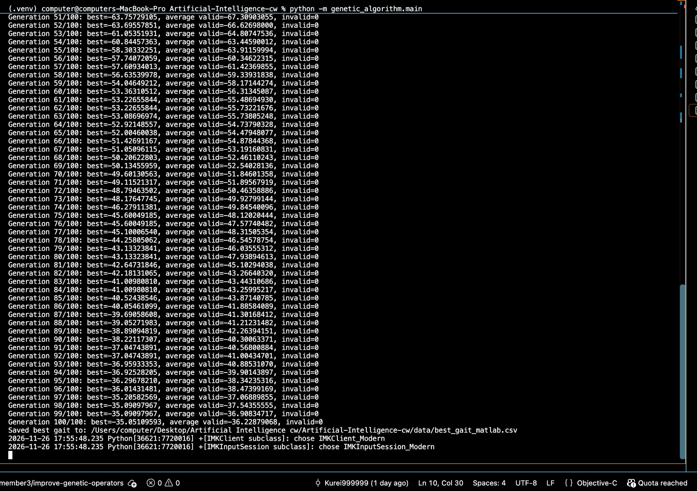
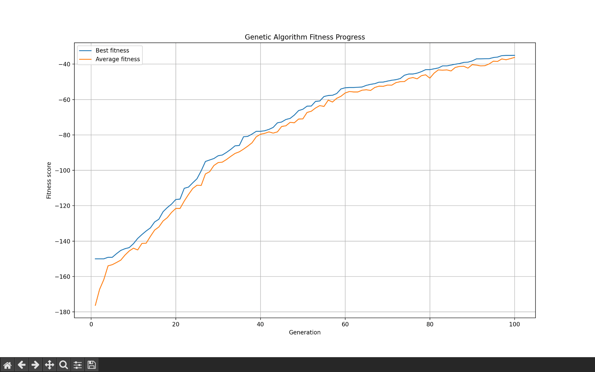
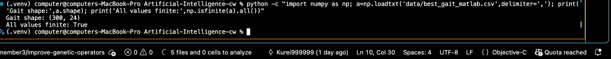

# Part 1 — Genetic Algorithm Integration Testing

**Module:** M33174 Artificial Intelligence  
**Date:** 26 November 2026  
**Testing branch:** `feature/integration-testing`

## Purpose

To check that the integrated Genetic Algorithm (GA) runs successfully, generates valid joint-angle data and produces output that can be visualised in MATLAB.

## Test Results

| Test | Result | Status |
|---|---|---|
| GA execution | Completed 100 generations | PASS |
| Fitness progression | Best fitness improved from approximately -150 to -35 | PASS |
| Invalid individuals | 0 reported in the final generation | PASS |
| Gait dimensions | 300 frames × 24 joint angles | PASS |
| Numerical validity | All generated joint angles were finite | PASS |
| MATLAB visualisation | Generated gait loaded and eight-legged spider model displayed | PASS |
| Ground plane | Ground-reference plane visible in the animation | PASS |

## Testing Procedure

**1. Run the Genetic Algorithm**

From the project root directory, using the Python environment with the required dependencies installed:

```bash
python -m genetic_algorithm.main
```

The GA completed 100 generations. In the recorded execution, the final best fitness was approximately **-35.0511**, with an average valid fitness of approximately **-36.2288** and **0 invalid individuals** reported in the final generation.

**2. Check fitness progression**

The generated `data/fitness_history.csv` file was used to plot the best and average valid fitness scores over 100 generations.

The fitness graph shows an overall improvement in both scores, indicating that the GA improved its evaluated candidate solutions during optimisation.

Because the GA uses randomised operations, individual runs may produce slightly different fitness histories and final scores.

**3. Validate the generated gait**

```bash
python -c "import numpy as np; a=np.loadtxt('data/best_gait_matlab.csv',delimiter=','); print(a.shape); print(np.isfinite(a).all())"
```

Output:

```text
(300, 24)
True
```

This confirms that the generated CSV contains 300 frames with 24 joint angles per frame, and that all values are finite.

**4. Visualise the gait in MATLAB**

Run `ga_main` from the project directory in MATLAB.

The generated spider gait was successfully loaded and displayed with all eight legs and the ground-reference plane visible.

The ground plane provides a visual reference for observing foot positions relative to the standing-pose ground height. It does not independently establish stable walking or collision-free movement.

## Evidence

**GA execution — 100 generations**

Terminal output showing the completed GA run, final fitness scores and invalid-individual count.



**GA fitness progression**

Graph showing the best and average valid fitness scores improving across 100 generations.



**CSV dimension and numerical validity**

Terminal output confirming the generated gait has dimensions `(300, 24)` and contains only finite values.



**MATLAB spider visualisation**

Screenshot showing the generated eight-legged spider gait with the ground-reference plane.


## Conclusion

The integrated Genetic Algorithm completed 100 generations and generated a numerically valid 300-frame joint-angle dataset. The recorded fitness progression shows improvement during optimisation.

MATLAB successfully loaded and visualised the generated gait with the ground-reference plane visible.

These tests provide evidence that the GA output and MATLAB visualisation work together. They do not verify physical walking stability, forward locomotion or the absence of ground penetration.
