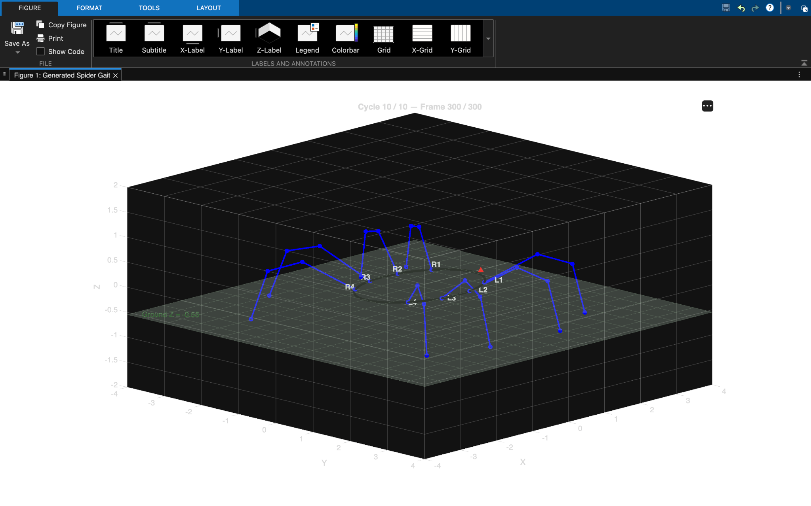

# Genetic algorithm design and integration tests

Part 1 generates a 300-frame gait for the eight-legged spider from M33174 Artificial Intelligence. The test below was recorded on 26 November 2026.

## Design

A chromosome is a flat array of 7,200 angles. The fitness function reshapes it into frames of 24 angles and uses forward kinematics to calculate foot positions. The population starts with sinusoidal variations around the MATLAB standing pose, with two groups of legs half a cycle apart. This gives the search smooth initial cycles with different amplitudes.

- Tournament selection samples three candidates and prefers the highest-scoring one. Weaker candidates can still win a tournament if the strongest are absent.
- Arithmetic crossover blends the two complete parent gaits. Sharing one blend weight across all frames and joints preserves coordination across the cycle.
- Mutation can add a smooth offset across 60 consecutive frames of each joint, wrapping at the end of the cycle. Each joint has a 0.1 chance of mutation and the amplitude is sampled from a normal distribution with standard deviation 0.15 rad. The output is kept within the joint bounds.
- Elitism copies the best candidate into the next generation. This preserves the best score even if the other new candidates score lower.

Fitness is the negative weighted sum of errors in support foot height, swing clearance, horizontal foot motion, ground penetration and gait smoothness. Position errors are scaled by their squared tolerances. Penetration uses the tightest tolerance and an extra weight, while the smoothness term penalises sudden changes in joint motion, including across the cycle boundary. Higher scores indicate smaller penalties under these criteria.

## Recorded test

| Check | Result |
| --- | --- |
| GA execution | Completed 100 generations |
| Best fitness | Improved from −150.0052 to −35.0511 |
| Average valid fitness | Improved from −176.2865 to −36.2288 |
| Invalid candidates in final generation | 0 |
| Gait output | 300 frames × 24 finite angles |
| MATLAB visualisation | Loaded the GA gait and displayed all eight legs and the reference ground plane |

Run the GA from the repository root in the [Python environment](../README.md#set-up-and-test). The run rewrites the gait used to train the final NN, so use a copy of the project to reproduce the GA while retaining the submitted data.

```bash
python -m genetic_algorithm.main
python -c "import numpy as np; a = np.loadtxt('data/best_gait_matlab.csv', delimiter=','); print(a.shape); print(np.isfinite(a).all())"
```

The CSV check prints `(300, 24)` and `True`. The GA uses seed 42 for population initialisation and the genetic operators. Its console output reports the best and average valid fitness and the number of invalid candidates each generation. The saved [fitness history](../data/fitness_history.csv) supplies the recorded curve.


[GA terminal output](screenshots/ga_execution.png) · [CSV validation](screenshots/ga_csv_validation.png)

Run `ga_main` from the project root in MATLAB to play the resulting gait. The reference plane is calculated from the standing pose and makes foot heights visible. The fixed-body animation provides a kinematic check. Walking stability, forward travel and physical ground contact require dynamics testing.


