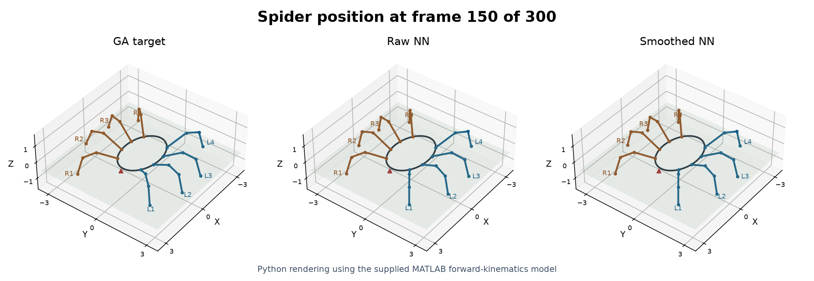

# Neural network evaluation

The neural network learns the relationship between phase and joint angles in the optimised GA gait. We checked the saved model on held-out phases, compared all 300 predicted frames with the GA reference, and checked whether smoothing improved the continuity of the cycle.

## Model and training

The target is [the Part 1 GA gait](../data/best_gait_matlab.csv), with 300 frames and 24 angles in radians per frame. For frame index `i` starting at zero, the two inputs are `sin(2πi/300)` and `cos(2πi/300)`. This encoding keeps the end of the cycle close to the start. The 24 outputs use the GA column order.

The network has three hidden layers of 64, 128 and 64 units. ReLU makes the mapping nonlinear, and the wider middle layer gives the model room to represent distinct trajectories for individual joints. The linear output produces continuous angles, which are checked against the joint limits during evaluation. There was no comparison against smaller architectures.

Training minimises mean squared error using NumPy and manual backpropagation. MSE fits the continuous outputs and penalises larger angle errors more heavily. Parameters are updated after each shuffled mini-batch with a fixed learning rate of 0.001. This setting reduced both training and validation error in the recorded run.

| Setting | Value |
| --- | ---: |
| Epochs | 2,000 |
| Batch size | 32 |
| Training and split seed | 42 |
| Training frames | 210 |
| Validation frames | 45 |
| Test frames | 45 |

The saved checkpoint comes from the epoch with the lowest validation MSE. The test set was used only to evaluate the selected checkpoint. The [configuration](../data/nn_final_info.json) and [training history](../data/nn_final_history.csv) record the final run. A repeat on Python 3.11.9 and NumPy 2.4.6 reproduced the saved loss history to its recorded precision. The largest absolute difference in model parameters was 2.22 × 10⁻¹⁶. To repeat the run, use `python -m neural_network.reference_training --epochs 2000` from the project root.

## Held-out performance and gait validation

| Split | MSE (rad²) |
| --- | ---: |
| Training | 0.00490353 |
| Validation | 0.00543094 |
| Test | 0.00511563 |

Test mean absolute error (MAE) was **0.05726265 rad**, or **3.28°**. A baseline that predicts the mean training angle for each joint at every phase reached a test MSE of **0.00626463 rad²**. The NN reduced test MSE by **18.3%** relative to that baseline.

The saved checkpoint predicts 300 frames of 24 finite angles with zero joint-limit violations. The output was exported without clipping. [Final metrics](../data/nn_final_metrics.json) · [Raw gait CSV](../data/nn_predicted_gait.csv)

## Visual results

Training MSE fell from 1.40615 to 0.00490 rad², while validation MSE fell from 1.41361 to 0.00543 rad² over 2,000 epochs.

The phase plots compare all 24 predicted angles with their GA targets. The largest full-cycle MSEs were at the R4 hip (0.00975 rad²), L1 hip (0.00951 rad²) and L4 knee (0.00854 rad²).

## Gait smoothing and playback

The 11-frame circular moving average smooths each joint trajectory across the cycle boundary. Roughness is the mean absolute second difference of the joint angles across the cycle, including the transition from the last frame to the first.

| Metric | GA target | Raw NN gait | Smoothed NN gait |
| --- | ---: | ---: | ---: |
| Roughness (rad) | 0.00029636 | 0.00188728 | 0.00065617 |
| Full-cycle MSE against GA (rad²) | — | 0.00501446 | 0.00469493 |

Smoothing reduced roughness by **65.23%** and full-cycle MSE by **6.37%** compared with the raw NN predictions. The smoothed gait still showed more than twice the roughness of the GA reference. These metrics include every frame from all three splits and quantify full-cycle reconstruction after post-processing. The held-out results above use the raw network outputs.

At frame 150 the raw and smoothed poses are close, with differences such as the L1 foot placement relative to the GA target still visible. The comparison uses the Python port of the supplied MATLAB geometry. It was cross-checked against a direct trigonometric calculation across all 300 frames of the three gaits, with a maximum joint-coordinate difference of 8.88 × 10⁻¹⁶.

In MATLAB, `ga_main` plays the reference gait and `nn_main` plays the raw or smoothed prediction with the same camera and body geometry. The viewer validates the selected CSV for shape, finite values and joint limits. The [MATLAB instructions](../README.md#view-the-saved-gaits) show how to select a gait.

## PyTorch comparison

To check the NumPy implementation, we trained a PyTorch model with the same architecture, initial parameters, split, mini-batches, learning rate and 2,000 epochs. The NumPy model calculates its gradients manually and the PyTorch model uses autograd.

| Held-out metric | NumPy | PyTorch |
| --- | ---: | ---: |
| MSE (rad²) | 0.00511563 | 0.00511563 |
| MAE (rad) | 0.05726265 | 0.05726265 |

The maximum absolute differences were **8.88 × 10⁻¹⁶** for test predictions and **2.22 × 10⁻¹⁶** for saved parameters. Under these matched conditions, the comparison supports the correctness of the manual implementation. [Comparison metrics](../data/pytorch_comparison.json) · [PyTorch training history](../data/pytorch_comparison_history.csv)

## Limitations

All three splits come from a single GA gait. Nearby phases can be in different splits, so the test evaluates interpolation within this gait. Generalisation to other gaits, speeds or terrain would need additional gaits and a split that holds out entire trajectories.

The linear output has no built-in joint limits. The exported values are within the bounds for this cycle, and a different model or input should be checked again. The periodic smoothing can also change the detail and timing of individual joint movements.

The kinematic viewer fixes the body and draws a reference ground plane. In the calculated poses, 420 of 2,400 foot positions were below that plane for the GA gait, compared with 565 for the raw NN and 544 for the smoothed NN. Smoothing removed some of these intersections. Forward movement, stability, physical ground contact and energy use would require a dynamics experiment that runs these specific gaits.
