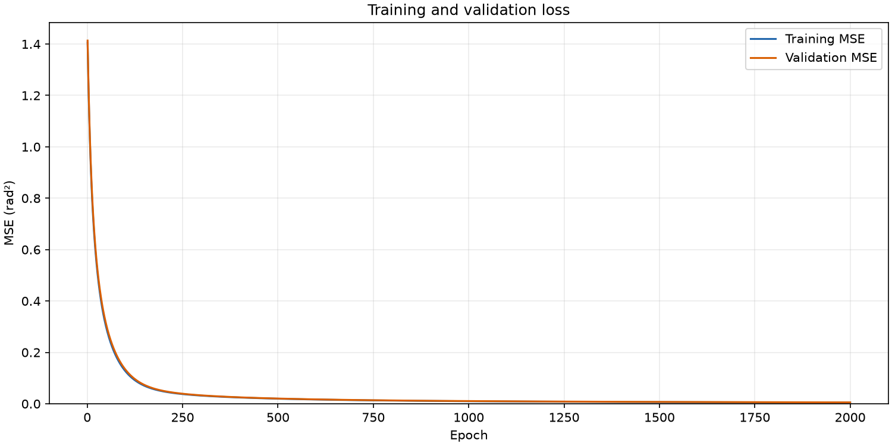
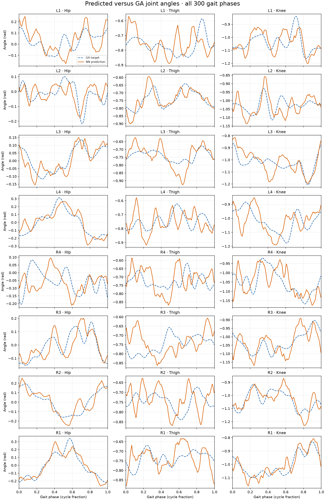
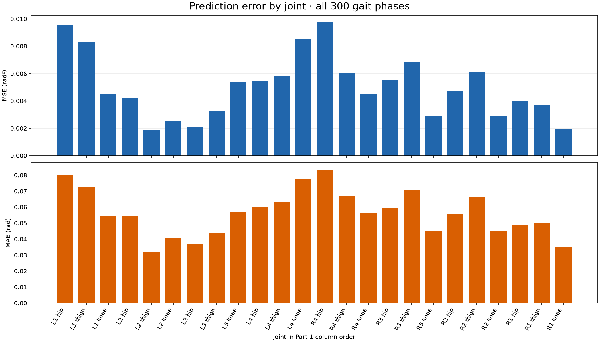

# Neural Network Evaluation and Comparison

## 1. Method and Architecture

The Neural Network was trained to reproduce the optimised spider gait generated by the Genetic Algorithm (GA). The training target is `data/best_gait_matlab.csv`, containing 300 frames and 24 joint angles per frame.

After training, the Neural Network generates joint-angle predictions saved in `data/nn_final_gait.csv`. Periodic smoothing is then applied to produce `data/nn_final_smoothed_gait.csv`. Both outputs are compared against the original GA gait to measure accuracy and movement smoothness.

Each network input represents a gait phase using sine and cosine values. This helps the network represent the repeating walking cycle.

The Neural Network uses the following architecture:

- Input layer: 2 neurons
- Hidden layer 1: 64 neurons
- Hidden layer 2: 128 neurons
- Hidden layer 3: 64 neurons
- Output layer: 24 neurons

The hidden layers use ReLU activation, while the output layer uses linear activation. The model is trained using mean squared error (MSE), mini-batch gradient descent and backpropagation implemented with NumPy.

## 2. Training Configuration

| Parameter          | Value     |
| ------------------ | --------- |
| Training epochs    | 2,000     |
| Learning rate      | 0.001     |
| Batch size         | 32        |
| Random seed        | 42        |
| Training samples   | 210 (70%) |
| Validation samples | 45 (15%)  |
| Test samples       | 45 (15%)  |

The dataset was divided into training, validation and test sets. The best checkpoint was selected using validation loss, while the test set was reserved for final evaluation.

The final trained model is saved as `data/nn_final_model.npz`.

Additional experiment files:

- `data/nn_final_history.csv` - training history.
- `data/nn_final_info.json` - experiment information.
- `data/nn_final_gait.csv` - raw NN predictions.
- `data/nn_final_smoothed_gait.csv` - periodically smoothed predictions.

### 2.1 Reproducibility Verification

The final Neural Network experiment was reproduced using the same GA
dataset, architecture, random seed, learning rate, batch size and
2,000 training epochs.

The reproduced checkpoint contained exactly the same parameter arrays
as the final saved model. The training histories were also identical,
with a maximum numerical difference of 0.0.

This confirms that the final experiment is reproducible under the
tested software environment and configuration.

python -m neural_network.reference_training --target data/best_gait_matlab.csv --model data/nn_reproduction_model.npz --history data/nn_reproduction_history.csv --provenance data/nn_reproduction_info.json --epochs 2000 --learning-rate 0.001 --batch-size 32 --seed 42

## 3. Evaluation Results

| Dataset    | MSE (rad²) |
| ---------- | ---------: |
| Training   | 0.00490353 |
| Validation | 0.00543094 |
| Test       | 0.00511563 |

The final model achieved a test mean absolute error (MAE) of **0.05726265 radians**, approximately **3.28 degrees**.

A constant-pose baseline achieved a test MSE of **0.00626463 rad²**. The trained NN achieved approximately **18.3% lower test MSE**, suggesting it learned variations in the GA-generated gait rather than only predicting a fixed pose.

## 4. Visualisation

Three graphs were generated to evaluate the final Neural Network.

### 4.1 Training and Validation Loss

This graph shows the training and validation losses recorded during the experiment.

### 4.2 GA Target Versus NN Predictions

This graph compares the predicted joint angles with the original GA-generated joint angles.

### 4.3 Prediction Errors by Joint

This graph shows the remaining prediction errors across the spider's joints.

## 5. MATLAB Gait Comparison

The following files were compared:

- **GA reference:** `data/best_gait_matlab.csv`
- **Raw NN predictions:** `data/nn_final_gait.csv`
- **Smoothed NN predictions:** `data/nn_final_smoothed_gait.csv`

### 5.1 Numerical Results

| Metric               |    GA gait | Raw NN gait | Smoothed NN gait |
| -------------------- | ---------: | ----------: | ---------------: |
| Roughness (rad)      | 0.00029636 |  0.00188728 |       0.00065617 |
| Full-gait MSE (rad²) |        N/A |  0.00501446 |       0.00469493 |

The raw Neural Network gait showed greater movement roughness than the original GA-generated gait.

Periodic smoothing was applied using a circular moving average across **11 frames**. This reduces abrupt changes while accounting for the transition between the final and first frames.

Smoothing achieved:

- **65.23% reduction** in roughness.
- **6.37% reduction** in full-gait MSE.

The smoothing process was applied after training. It does not change the Neural Network architecture or improve the training algorithm itself.

The full-gait MSE is calculated across all 300 frames, including the training, validation and test phases. It should not be reported as held-out test performance.

### 5.2 MATLAB Animation

The `nn_main.m` script was used to visualise the raw and smoothed NN walking gaits.

The NN animation uses the same spider geometry and camera settings as the GA animation, allowing visual comparison of the joint movements.

The `validate_smoothed_gait.m` script checks that the output contains 300 frames and 24 joint angles, contains finite values, and remains within the permitted joint limits.

## 6. Limitations

The Neural Network was trained using a single GA-generated gait. Although the dataset contains separate training, validation and test frames, neighbouring phases are closely related.

Therefore, the test results demonstrate how accurately the NN reproduces unseen phases of the same gait, rather than how well it generalises to different walking patterns, speeds or environments.

MATLAB animation demonstrates joint movement but does not independently establish physical walking stability, forward movement or energy efficiency.

Periodic smoothing improves movement continuity but may also change the detailed joint trajectories.

## 7. Conclusion

The final Neural Network successfully approximated the optimised GA-generated gait, achieving a held-out test MSE of **0.00511563 rad²** and outperforming the constant-pose baseline.

The raw NN predictions showed greater roughness than the original GA gait. Applying periodic smoothing reduced roughness by **65.23%** and improved full-cycle reconstruction accuracy.

Overall, the results demonstrate a functioning GA-to-NN pipeline for generating, learning and visualising a spider walking gait. Further physical simulation would be necessary to evaluate actual movement stability and performance.
