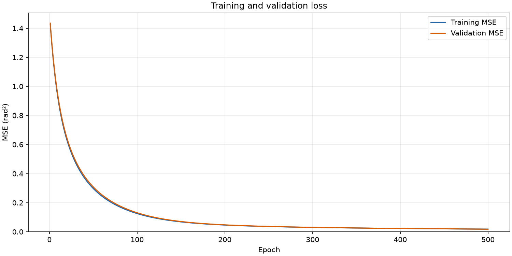
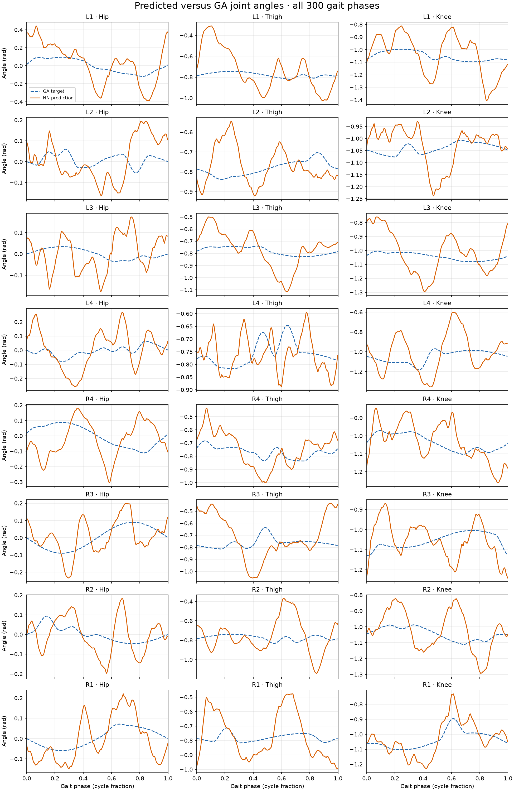
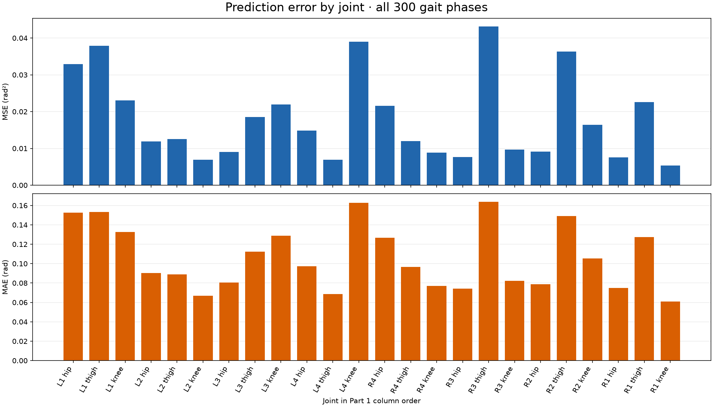

# Neural network evaluation and comparison

## Method and reproducibility

The evaluator reloads a saved NumPy checkpoint and predicts one pose for each of the 300 ordered gait phases. Inputs are `[sin(2*pi*i/300), cos(2*pi*i/300)]`, for `i = 0,...,299`. Outputs are 24 angles in radians in the Part 1 order: L1, L2, L3, L4, R4, R3, R2, R1; hip, thigh and knee for each leg. The target is `data/best_gait_matlab.csv`. Evaluation does not change the team's dataset, network, training algorithm or lecturer's forward-kinematics code.

No trained checkpoint was published in `main` at the start of this work. The committed `nn_reference_model.npz` is therefore explicitly a **reference model**, trained with the existing team's `train()` function and its defaults: architecture 2-64-128-64-24, seed 42, 500 epochs, learning rate 0.001, batch size 32, ReLU hidden layers and linear outputs. The existing dataset split uses seed 42 and 210 training, 45 validation and 45 test phases. Test phases were not used in the training updates. This checkpoint is not presented as the team's final selected model. `data/nn_reference_training.json` records parameters, runtime versions and hashes of the source, target, checkpoint and history.

## Metrics and observations

For prediction error `e = prediction - GA target`, MSE is the mean of `e^2` (rad²) and MAE is the mean of `abs(e)` (rad), over samples and all 24 joints. The JSON also reports both metrics separately for each joint.

| Evaluation samples | MSE (rad²) | MAE (rad) |
| --- | ---: | ---: |
| Training phases (210) | 0.0180912015 | 0.105915652 |
| Validation phases (45) | 0.0179739493 | 0.106144687 |
| Test phases (45) | 0.0186666717 | 0.108186058 |
| Full gait (300, includes training phases) | 0.0181599342 | 0.106290568 |
| Constant training-mean angles on test phases | 0.0018013600 | 0.0340502942 |

Training/validation MSE falls from 1.42594/1.43471 after epoch 1 to 0.01809/0.01797 after epoch 500. Both sets improve, but improvement alone does not establish an adequate fit: the test MSE is approximately **10.36 times** the training-mean baseline. A constant configuration cannot express a walking cycle; its low reconstruction error here reflects the gait's limited variation around its standing configuration. The reference model therefore has not demonstrated useful reconstruction of the detailed GA trajectory. Additional training or architecture/learning-rate selection using validation data is needed before claiming an accurate learned controller.

The largest full-gait joint MAE is 0.163817 rad at R3's thigh. All 7,200 predicted angles are finite and within the repository's per-joint limits, without clipping. The largest predicted adjacent-frame change, including the loop boundary, is 0.0338235 rad, compared with 0.0106705 rad for the GA target. The last-to-first change is 0.0150806 rad for the NN and 0.00447429 rad for the target. These values describe continuity; no universal speed/stability acceptance threshold is inferred from them.

## Figures

The comparison plots show all joints and all phases, including training phases. They are descriptive full-cycle views; the separate test metrics above are the held-out measurements.

## MATLAB testing status

`main_nn.m` is a separate playback entry point based on `main.m`. It validates the required 300-by-24, finite, in-range CSV, calls the existing `plot_spider_pose` for all frames, and saves snapshots at frames 1, 75, 150, 225 and 300 into `images/nn/`. The original `main.m`, `plot_spider_pose.m` and `forward_leg_kinematics2.m` are unchanged.

**MATLAB playback has not been verified in this environment:** no local MATLAB runtime is available and MATLAB Online requires account sign-in. No MATLAB screenshots or visual observations are claimed. To complete this check, open the repository in MATLAB, set Current Folder to the repository root and run `main_nn`. Record the MATLAB release, confirm that the full cycle runs without errors, inspect all legs for discontinuities or implausible poses, compare against `main.m`, and include the generated snapshots. The Python contract checks do not substitute for MATLAB execution.

## Limitations

- Training, validation and test samples are shuffled phases from a **single** gait. Nearby phases are strongly related, so the test score measures interpolation on that gait, not generalisation to new GA runs, speeds or terrains. Independent gait cycles should be held out for those claims.
- Joint limits and angle accuracy do not establish forward travel, stable foot contact, collision avoidance or low energy use. The MATLAB plot holds the body fixed and is a kinematic visual check, not a physics experiment.
- Linear network outputs are unconstrained. The evaluator rejects invalid predictions instead of silently clipping or replacing an existing valid export. A different checkpoint must be rechecked.
- Checkpoint and history paths can be supplied for the team's final model. They must come from the same training run; this reference is not a substitute for agreeing on that final checkpoint with Member 3.
